# Статистический анализ e-commerce

**Период:** 1 января — 29 июня 2025 года  
**Объём данных:** 5 000 уникальных посетителей  
**Инструменты:** Python, pandas, NumPy, SciPy, statsmodels, Matplotlib, Seaborn  
**Исходные расчёты:** [`statistical_analysis.ipynb`](../notebooks/statistical_analysis.ipynb)

## Главное

Из 5 000 посетителей покупку совершили **1 820 человек (36,40%)**. Средняя выручка на одного посетителя — **34,93**, а средний чек среди покупателей — **95,96** при медиане **52,88**. Значит, крупные заказы заметно поднимают среднее, и оценивать покупки только по нему рискованно.

Статистически значимых различий **конверсии** между кампаниями, источниками трафика и регионами не обнаружено. Зато найдены различия **распределений сумм покупок** между некоторыми регионами. Время на сайте тесно связано с фактом покупки, но нельзя считать доказанным, что увеличение времени само вызовет рост конверсии.

Ниже — весь путь исследования: что проверяли, как интерпретировали результаты и какие решения можно предложить бизнесу. Графики даны рядом с соответствующими разделами.

## A. Описание данных и статистика

### Проверка данных

Проверили объём данных, уникальность пользователей, пропуски и типы столбцов. Получили **5 000 строк и 14 признаков**; каждый `customer_id` уникален. Исправили типы даты, суммы покупки и времени на сайте (в CSV десятичные дроби были записаны через запятую). Данные охватывают январь–июнь 2025 года. Пропуски кампании за пределами PaidAds структурные, а не случайные.

### Типы переменных

Разделили переменные на количественные, категориальные, бинарные и порядковые. В частности, `converted` — бинарный показатель, а `satisfaction` — порядковая оценка. Такая классификация определяет, какие описательные характеристики и тесты применять.

### Распределения и выводы

Покупку совершили **1 820 из 5 000** посетителей (**36,40%**). Средняя сумма на посетителя — **34,93**; у **63,6%** покупок нет, поэтому общая медиана равна нулю. Среди покупателей средний чек — **95,96**, медиана — **52,88**. На гистограммах ниже видно выраженную асимметрию: редкие крупные покупки поднимают среднее. Для бизнеса поэтому важны не только средний чек, но и медиана и квантили.

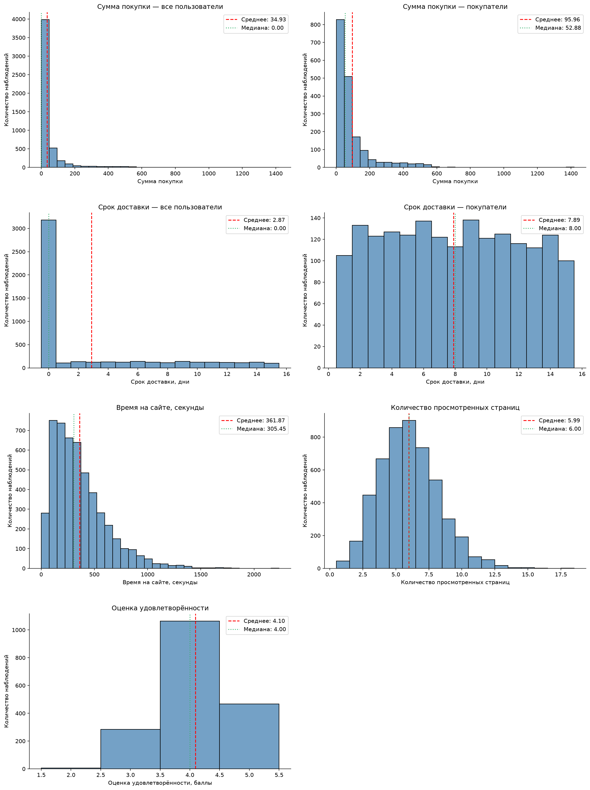

*График: распределения и выводы.*

## B. Формирование выборок

### Как сформировали выборки

Сформировали по **800 уникальных пользователей** тремя способами: случайным, стратифицированным по региону и систематическим (шаг **6**). Это позволило сравнить, насколько разные схемы отбора сохраняют характеристики исходных данных.

### Сравнение с генеральной совокупностью

Средняя сумма на посетителя составила **29,78** в случайной выборке, **38,38** в стратифицированной и **33,71** в систематической при генеральном значении **34,93**. Конверсия — соответственно **33,88%, 37,50% и 34,50%** против **36,40%**. График ниже показывает близость средних к генеральному значению. В этом отборе систематическая выборка лучше оценила среднюю сумму, а стратифицированная — конверсию.

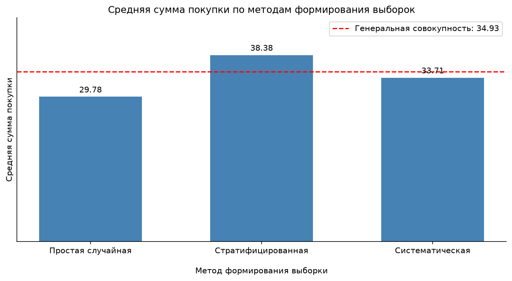

*График: сравнение с генеральной совокупностью.*

## C. Репрезентативность

### Отклонения от генерального среднего

Относительные отклонения средних составили **−14,73%** для случайной, **+9,88%** для стратифицированной и **−3,48%** для систематической выборки. Ниже видно и величину, и направление ошибки. По заданному критерию наиболее репрезентативной оказалась **систематическая**.

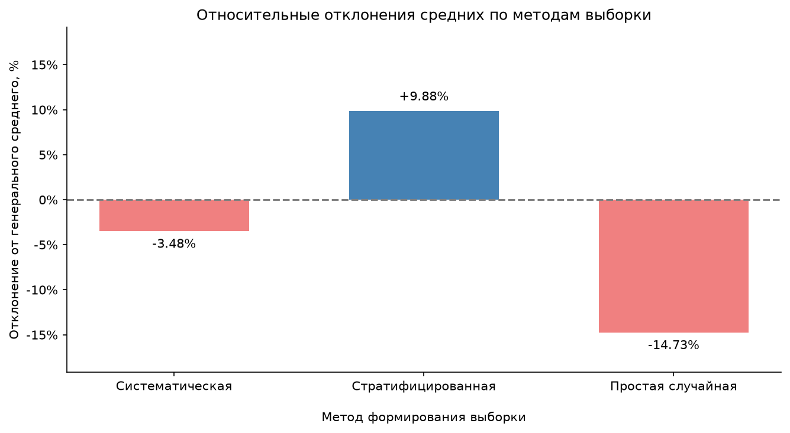

*График: отклонения от генерального среднего.*

### Дисперсия и региональная стратификация

Систематическая выборка также ближе всего воспроизвела дисперсию (отклонение **−13,32%**). Стратификация по регионам не улучшила оценку среднего: средние по регионам близки (**32,20–36,65**), а разброс внутри регионов велик. Это результат **одного эксперимента**, а не доказательство превосходства метода всегда.

## D. Доверительные интервалы

### Средняя сумма покупки

Для среднего **34,93** по всем 5 000 наблюдениям 95%-й интервал составил **[32,51; 37,35]**. Для случайной выборки — **[25,10; 34,46]**, стратифицированной — **[32,14; 44,62]**, систематической — **[28,54; 38,88]**. На графике ниже точки показывают средние, отрезки — неопределённость. Самый узкий интервал не обязательно означает самое близкое к генеральному значение.

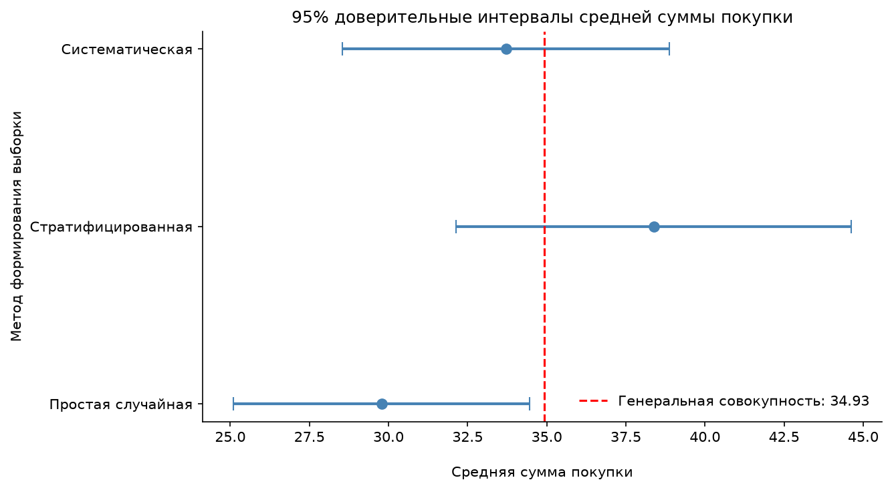

*График: средняя сумма покупки.*

### Конверсия

Общая конверсия — **36,40%**, 95%-й интервал **[35,08%; 37,74%]**. Для трёх выборок интервалы: **[30,95%; 36,95%]**, **[34,49%; 40,63%]**, **[31,56%; 37,59%]**. Все они включают генеральную конверсию. На графике видно, что при одинаковом объёме выборок интервалы имеют близкую ширину.

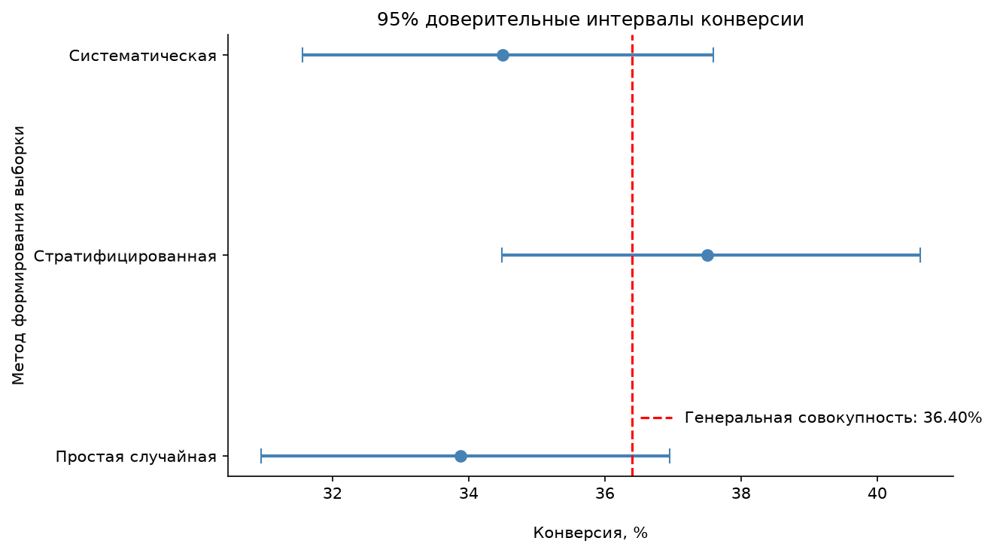

*График: конверсия.*

### Общий вывод

Интервалы отражают неопределённость оценки, а не гарантируют, что выбранная выборка воспроизведёт генеральное значение точно. Для стратифицированной и систематической схем расчёты приближённые.

## E. ЦПТ и закон больших чисел

### Распределения выборочных средних

Для размеров **n = 5, 30, 100** по **1 000 раз** выбирали наблюдения и рассчитывали среднее. При n = 5 распределение средних ещё сильно асимметрично; при n = 30 становится ровнее; при n = 100 уже заметно ближе к нормальному. Это видно на гистограммах и Q–Q-графиках ниже: с ростом n точки располагаются ближе к диагонали. Результат согласуется с ЦПТ.

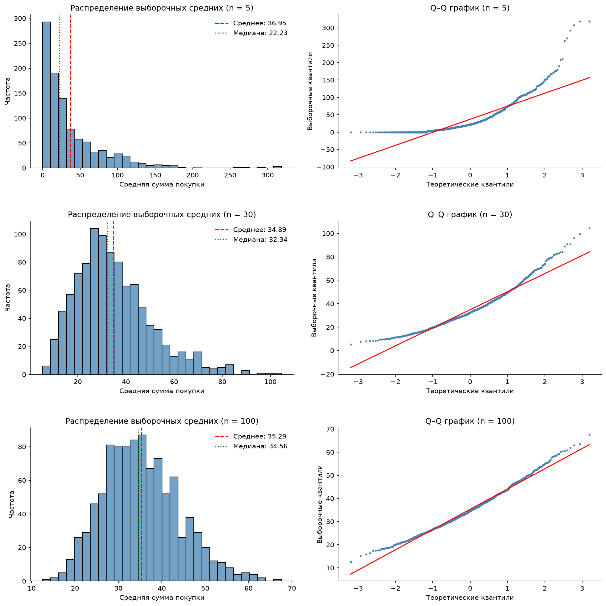

*График: распределения выборочных средних.*

### Как меняется дисперсия средних

Эмпирическая дисперсия выборочных средних уменьшилась с **1 819,22** (n = 5) до **249,32** (n = 30) и **77,32** (n = 100). График ниже подтверждает закономерность: чем больше выборка, тем стабильнее среднее. Значения в целом согласуются с теоретической зависимостью `σ²/n`.

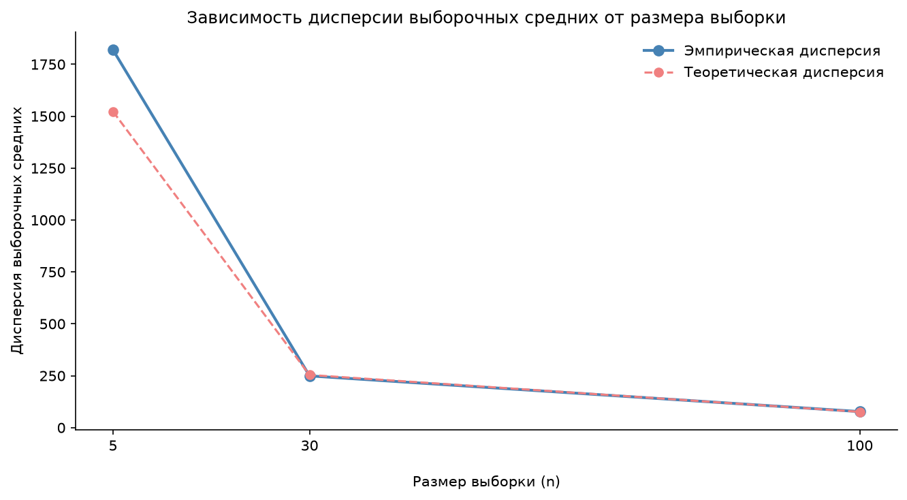

*График: как меняется дисперсия средних.*

## F. Подбор распределения

### Оценка параметров и AIC

Для **положительных** сумм покупок методом максимального правдоподобия оценили логнормальное, логлогистическое, гамма-распределение и распределение Вейбулла. Лучший AIC у **логнормальной модели: 19 724,33** (`shape = 0,91`, `scale = 59,77`); у ближайшей логлогистической модели — **19 736,58**.

### Проверка модели

Сравнили эмпирическую и теоретические плотности, а также Q–Q-графики. Ниже видно, что логнормальная модель достаточно хорошо описывает общую форму, но не точно воспроизводит крупные покупки. Логлогистическая ещё сильнее расходится с данными в правом хвосте.

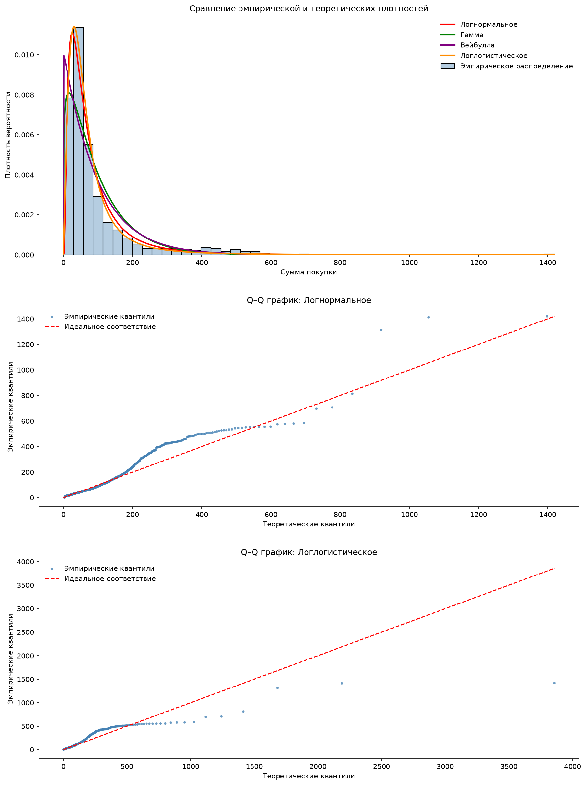

*График: проверка модели.*

### Пригодность для прогнозов

Логнормальное распределение подходит для **приближённых симуляций** сумм заказов, но для точного прогноза крупных покупок его недостаточно без дополнительной проверки. При моделировании всей выручки нужно отдельно учитывать вероятность конверсии.

## G. Свойства оценок

### Среднее

Для **n = 10, 50, 200** выполнили по **1 000 повторений**. Средние оценки суммы покупки — **33,81; 35,42; 35,02** при генеральном **34,93**. На графике ниже распределение с ростом n сужается: стандартное отклонение оценок падает с **28,20** до **5,84**. Результаты согласуются с несмещённостью и состоятельностью среднего.

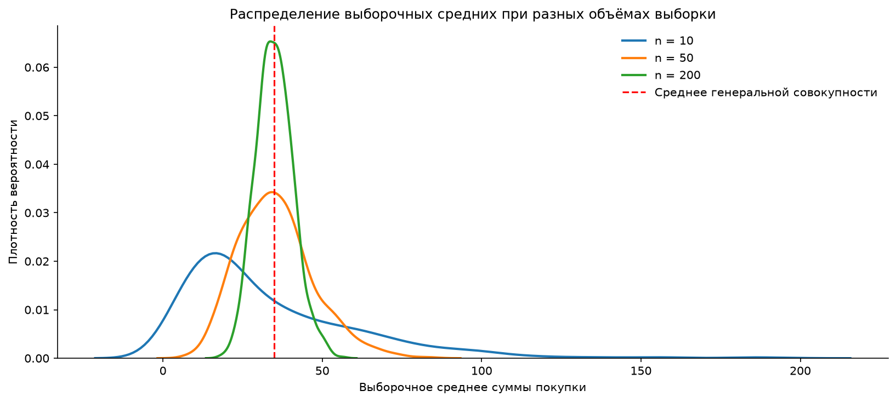

*График: среднее.*

### Конверсия

Средние оценки конверсии для n = 10, 50, 200 — **35,49%; 36,73%; 36,28%** против генеральных **36,40%**. Разброс уменьшается с **14,76** до **3,34 процентного пункта**. График показывает, насколько ненадёжны маленькие выборки и как растёт устойчивость оценки.

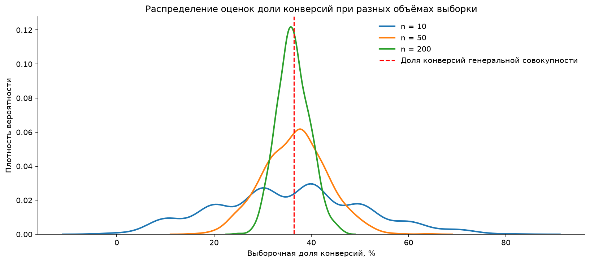

*График: конверсия.*

### Дисперсия

Сравнили дисперсию с делителем `n` (`ddof=0`) и `n−1` (`ddof=1`). При n = 10 поправка Бесселя уменьшила эмпирическое смещение с **−747,64** до **15,23**, но не обязательно уменьшала RMSE. Графики ниже показывают длинные правые хвосты: редкие дорогие заказы сильно влияют на дисперсию.

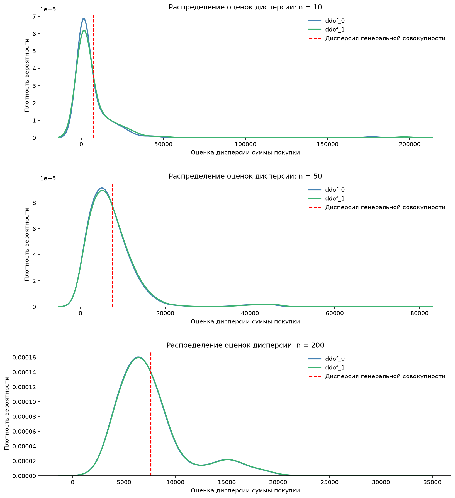

*График: дисперсия.*

## H. Бизнес-анализ

### Кампании и источники трафика

Среди кампаний **CAMP7** лидирует по выручке на посетителя (**44,08**), **CAMP6** — по конверсии (**39,02%**). Среди источников **Referral** лидирует по конверсии (**41,33%**) и выручке на посетителя (**39,47**). Два графика ниже показывают, что лидеры по конверсии и выручке не всегда совпадают.

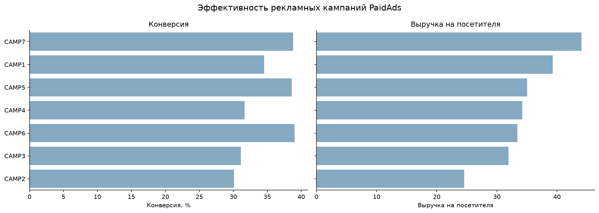

*График: кампании и источники трафика.*

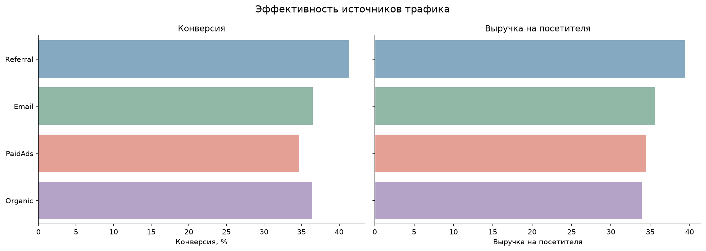

*График: кампании и источники трафика.*

### Проверка различий конверсии

Проверили конверсию критерием χ²: по кампаниям **p = 0,1587**, по источникам **p = 0,0617**. При α = 0,05 статистически значимых различий не выявлено. Наблюдаемые лидеры — повод для дальнейших проверок, но не основание немедленно перераспределять бюджет.

### Суммы покупок

Критерий Краскела — Уоллиса не выявил значимых различий распределений сумм покупок среди покупателей ни по кампаниям (**p = 0,8153**), ни по источникам (**p = 0,7581**). Без рекламных расходов также невозможно оценить реальную окупаемость каналов.

### Регионы

**East** лидирует по среднему чеку (**104,28**) и выручке на посетителя (**36,65**). График ниже позволяет сравнить регионы по конверсии и выручке. Различия конверсии статистически незначимы (**χ², p = 0,5535**), зато распределения сумм покупок различаются (**Краскел — Уоллис, p < 0,001**).

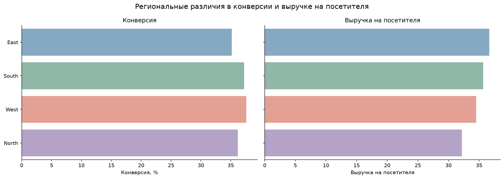

*График: регионы.*

### Попарные сравнения

Попарные сравнения Манна — Уитни с поправкой Холма выявили различия между **East и North** и **East и South**. Для **East и West** значимости после поправки нет. Речь о различиях распределений/рангов, а не о прямом доказательстве различий арифметических средних.

### Поведенческие различия

Покупатели проводят на сайте в среднем **496,12 с**, посетители без покупки — **285,04 с**. Различие значимо (**p < 0,001**). Количество просмотренных страниц практически одинаково — **5,95** и **6,01**, значимого различия нет. На графике ниже распределение времени у покупателей смещено вправо, а распределения страниц близки.

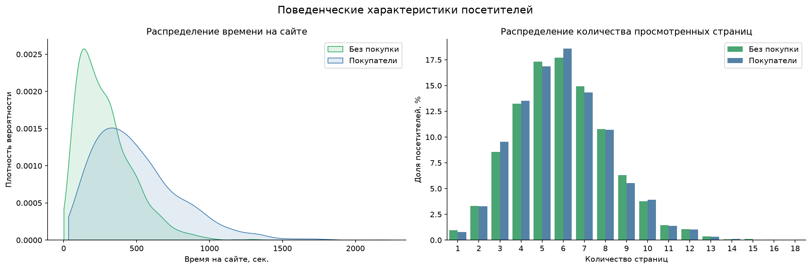

*График: поведенческие различия.*

### Связь с суммой покупки

Среди покупателей корреляции Спирмена суммы заказа со временем и числом страниц очень малы (около **0,02–0,03**) и статистически незначимы. То есть более долгое посещение связано с **фактом покупки**, но не показало заметной связи с **размером чека**.

### Временные сегменты

Разделили посетителей на пять квинтилей по времени на сайте. Конверсия последовательно выросла с **13,39%** в первом до **67,60%** в пятом. Линейный график ниже показывает этот градиент. Но время может включать оформление заказа, поэтому связь не доказывает, что искусственное увеличение времени повысит продажи.

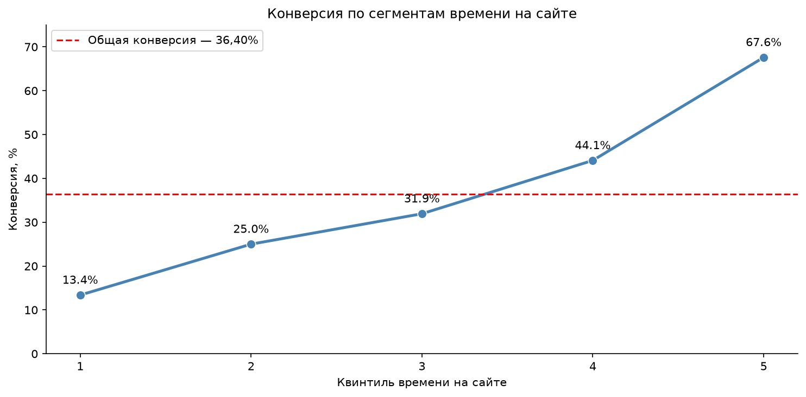

*График: временные сегменты.*

### Бизнес-рекомендации

На основании проведённого анализа можно выделить четыре направления, которые представляют наибольший интерес для дальнейшего развития бизнеса.

#### 1. Оценка эффективности рекламных кампаний и источников трафика

Среди рекламных кампаний наибольшую выручку на посетителя показала **CAMP7 (44,08)**, а среди источников трафика самая высокая конверсия наблюдалась у **Referral (41,33%)**.

Однако статистические тесты не подтвердили значимых различий конверсии между кампаниями (p = 0,1587) и источниками трафика (p = 0,0617). Поэтому считать отдельные каналы более эффективными только на основании текущих результатов преждевременно.

**Рекомендации:**
- Не перераспределять рекламный бюджет исключительно по наблюдаемой конверсии.
- Рассматривать CAMP7 и Referral как перспективные направления для дальнейшей проверки.
- Добавить данные о рекламных расходах и рассчитывать CAC, ROAS и прибыльность привлечения.
- Проверять изменения маркетинговой стратегии на новых данных или с помощью контролируемых экспериментов.

**Главный вывод:** высокая конверсия или выручка на посетителя ещё не означает высокую экономическую эффективность. Для принятия решений необходимо учитывать стоимость привлечения и прибыль.

#### 2. Исследование региональных различий

Регион **East** показал самый высокий средний чек — **104,28**, а также максимальную выручку на посетителя — **36,65**.

При этом статистически значимых различий конверсии между регионами не обнаружено (p = 0,5535). Зато выявлены различия распределений сумм покупок (p < 0,001). Попарные сравнения с поправкой Холма подтвердили различия между East и North, а также East и South.

**Рекомендации:**
- Изучить ассортимент и товарные категории, которые чаще покупают в East.
- Сравнить структуру корзин и характеристики покупателей в East, North и South.
- Проверить, связаны ли различия с ценами, ассортиментом или особенностями аудитории.
- На основе полученных результатов сформировать гипотезы для региональных предложений и персонализации.

**Главный вывод:** региональные различия представляют интерес прежде всего с точки зрения структуры и размера покупок, а не конверсии. При этом обнаруженные статистические различия распределений ещё не доказывают, что средние чеки регионов различаются статистически значимо.

#### 3. Анализ поведения посетителей

Наиболее заметная поведенческая закономерность связана со временем пребывания на сайте.

Покупатели проводят на сайте в среднем **496,12 секунды**, а посетители без покупки — **285,04 секунды**. Различие статистически значимо (p < 0,001).

Кроме того, конверсия последовательно увеличивается от **13,39% до 67,60%** при переходе от первого к пятому квинтилю времени посещения.

При этом количество просмотренных страниц не показало значимых различий между покупателями и остальными посетителями. Также не обнаружено значимой связи времени посещения и количества страниц с суммой заказа среди покупателей.

**Рекомендации:**
- Дополнить данные событиями пользовательского пути: просмотрами товаров, добавлениями в корзину и началом оформления заказа.
- Выяснить, какие действия предшествуют покупке и могут служить признаками заинтересованности посетителя.
- Проверять персонализированные предложения и изменения интерфейса с помощью A/B-тестов.
- Не стремиться искусственно увеличивать время пребывания на сайте: длительное посещение само по себе не гарантирует покупку.

**Главный вывод:** время на сайте может быть полезным показателем для поведенческой аналитики, но пока нельзя утверждать, что именно оно влияет на вероятность покупки. Для этого необходимо отдельно исследовать действия посетителя до оформления заказа.

#### 4. Анализ среднего чека и крупных покупок

Средний чек среди покупателей составляет **95,96**, а медианный — **52,88**. Такая разница связана с выраженной правосторонней асимметрией распределения: сравнительно небольшое количество крупных заказов заметно повышает среднее значение.

**Рекомендации:**
- Использовать средний чек вместе с медианой и квантилями распределения.
- Отдельно исследовать крупные заказы и их вклад в общую выручку.
- Изучить категории товаров и состав корзин, которые связаны с более высокими суммами покупок.
- При сравнении покупательских сегментов учитывать влияние крупных заказов на средние показатели.

**Главный вывод:** средний чек не всегда отражает размер типичной покупки. Для оценки покупательского поведения и поиска возможностей увеличения выручки необходимо анализировать всё распределение сумм заказов.

### Статистические риски и ограничения исследования

При интерпретации результатов важно учитывать несколько ограничений, которые могут влиять на точность выводов и возможность их практического применения.

#### 1. Влияние крупных покупок

Распределение сумм покупок сильно смещено вправо: средний чек **95,96** значительно превышает медиану **52,88**.

Крупные заказы повышают среднее значение и увеличивают разброс данных. Поэтому сравнение групп исключительно по средним может создавать неполное представление о покупательском поведении.

В исследовании дополнительно использовались медианы, характеристики распределений и непараметрические критерии. Однако влияние крупных покупок необходимо учитывать и при дальнейшем анализе.

#### 2. Ограничения выборочного анализа

В работе сравнивались три метода формирования выборок по 800 наблюдений. Систематическая выборка оказалась наиболее близкой к генеральной совокупности по средней сумме покупки, но этот результат относится только к конкретному эксперименту.

Даже при одинаковом объёме выборки оценки могут различаться из-за случайности отбора. Кроме того, увеличение объёма выборки уменьшает случайную ошибку, но не устраняет возможное систематическое смещение.

Исходные данные охватывают только **январь — июнь 2025 года**, поэтому обнаруженные закономерности необязательно сохранятся в другие периоды.

#### 3. Множественные статистические проверки

В исследовании проводилось несколько проверок различий между рекламными кампаниями, источниками трафика, регионами и поведенческими группами.

Чем больше статистических тестов проводится, тем выше вероятность случайно получить значимый результат.

Для снижения этого риска при попарных сравнениях применялась **поправка Холма**, которая учитывает множественность проверок.

Однако корректировка проводилась внутри отдельных наборов сравнений, а не для всех гипотез исследования одновременно. Поэтому обнаруженные закономерности желательно дополнительно проверять на новых данных.

#### 4. Статистическая и практическая значимость

Статистически значимое различие не всегда означает существенную пользу для бизнеса.

Например, мы обнаружили различия распределений сумм покупок между регионами, но пока не знаем, насколько выгодно разрабатывать отдельные предложения для каждого из них.

И наоборот, отсутствие статистической значимости не доказывает, что различий между группами вообще нет.

Поэтому при принятии решений важно учитывать не только p-value, но и величину эффекта, доверительные интервалы, затраты и ожидаемую экономическую выгоду.

#### 5. Ограничения применённых критериев

Для сравнения сумм покупок использовались критерии Краскела — Уоллиса и Манна — Уитни.

Эти методы подходят для анализа данных с выраженной асимметрией, но не являются непосредственными тестами равенства арифметических средних.

Поэтому статистически значимые различия между регионами следует интерпретировать как различия распределений сумм покупок, а не как доказательство различий средних чеков.

#### 6. Отсутствие доказанной причинно-следственной связи

В исследовании обнаружена выраженная связь времени пребывания на сайте с фактом покупки.

Однако более длительное посещение может быть следствием самого процесса оформления заказа. Кроме того, на время посещения и вероятность покупки могут одновременно влиять другие факторы.

Поэтому нельзя утверждать, что увеличение времени на сайте приведёт к росту конверсии.

Для проверки таких гипотез необходимы более подробные данные о последовательности действий посетителей и контролируемые эксперименты.

#### 7. Недостаток бизнес-данных

В датасете отсутствуют рекламные расходы, себестоимость товаров, состав корзины и точное время совершения покупки внутри посещения.

Из-за этого невозможно полноценно оценить окупаемость маркетинговых каналов, причины различий в суммах заказов и эффективность поведенческих сценариев до покупки.

**Общий вывод по ограничениям:** полученные результаты позволяют выявить интересные закономерности и сформировать гипотезы, но не все из них можно сразу использовать для принятия управленческих решений. Для этого потребуются дополнительные данные и подтверждающие проверки.

## Итоговые выводы

В ходе исследования были проанализированы данные **5 000 посетителей интернет-магазина** за первое полугодие 2025 года. Работа охватывала описательную статистику, формирование выборок, доверительные интервалы, моделирование статистических закономерностей и проверку бизнес-гипотез.

### 1. Основные результаты статистического анализа

**Распределение покупок неоднородно.** Общая конверсия составила **36,40%**, средний чек покупателей — **95,96**, медианный — **52,88**. Значительная разница между средним и медианой показывает, что крупные покупки заметно влияют на показатели выручки.

**Способ формирования выборки влияет на результат.** Среди трёх рассмотренных методов систематическая выборка наиболее точно воспроизвела среднюю сумму покупки: относительное отклонение составило **−3,48%**. Стратифицированная выборка лучше остальных оценила конверсию. Это подтверждает необходимость выбирать метод отбора с учётом исследуемого показателя.

**Доверительные интервалы позволяют учитывать неопределённость.** Даже выборки одинакового размера могут давать разные оценки и интервалы. Поэтому при анализе важно оценивать не только отдельное число, но и возможный диапазон значений.

**Увеличение объёма выборки повышает устойчивость оценок.** Моделирование центральной предельной теоремы и свойств статистических оценок показало, что с ростом числа наблюдений разброс выборочных средних и оценок конверсии уменьшается.

**Для моделирования положительных сумм покупок наиболее подходящей из рассмотренных оказалась логнормальная модель.** Однако её соответствие реальным данным не идеально, особенно в области крупных заказов. Поэтому использовать её для прогнозирования следует с осторожностью.

### 2. Основные результаты бизнес-анализа

**Маркетинговые каналы различаются по наблюдаемым показателям, но статистически значимых различий конверсии не выявлено.** CAMP7 лидирует по выручке на посетителя, а Referral — по конверсии среди источников трафика. Однако этих результатов недостаточно, чтобы считать их наиболее эффективными с экономической точки зрения.

**Региональные различия обнаружены прежде всего в распределениях сумм покупок.** East показывает самый высокий наблюдаемый средний чек, а статистические проверки выявили различия между East и регионами North и South. Это направление заслуживает дополнительного изучения.

**Время пребывания на сайте связано с вероятностью совершения покупки.** Покупатели проводят на сайте значительно больше времени, а наблюдаемая конверсия возрастает от **13,39% до 67,60%** между крайними квинтилями длительности посещения. При этом причинное влияние времени на конверсию не доказано.

**Количество просмотренных страниц не оказалось значимым фактором различия между покупателями и посетителями без покупки.** Также не выявлено значимой монотонной связи рассмотренных поведенческих показателей с суммой заказа среди покупателей.

### 3. Практический результат исследования

Главная ценность проведённого анализа заключается не только в полученных статистических результатах, но и в определении направлений для дальнейшей работы с данными.

В первую очередь целесообразно развивать **поведенческую аналитику**, исследовать **региональные особенности покупок**, дополнить маркетинговые данные **затратами на привлечение** и подробнее изучить **структуру крупных заказов**.

Полученные результаты дают основу для формирования проверяемых гипотез. Следующий этап — подтвердить наиболее перспективные из них на новых данных и с помощью контролируемых экспериментов, чтобы перейти от обнаружения статистических закономерностей к обоснованным бизнес-решениям.